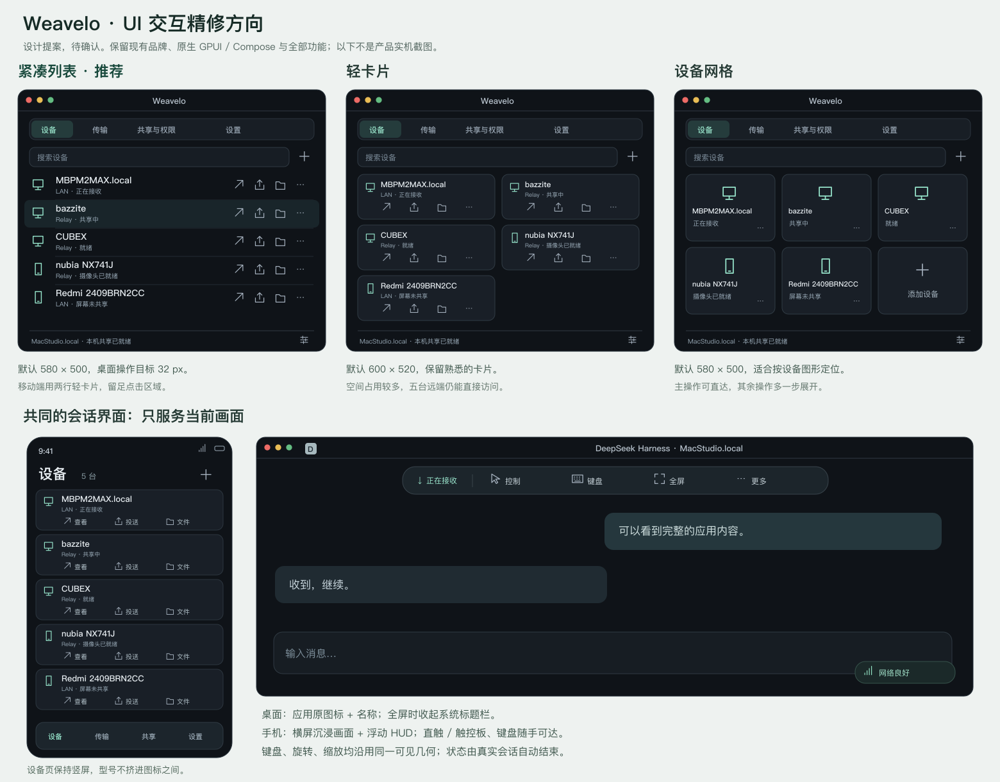

# Weavelo UI 与交互精修提案

2026-11-04 · **待用户确认，尚未实施整体布局调整。**

当前功能修复为 `fbaa71e` / 桌面 111，四台电脑均已安装并核对实际进程；下载站三个完整包的 SHA 已验证。31 项相关原生检查及 1,045 项签名发布回归通过。专用单应用窗口实机验证了点击、双指滚动和精确文字输入；MacBook 原生接收窗口的 DeepSeek Harness 图标、名称也已核对。该聊天未被写入，MacBook 实体触控板与该聊天的实际输入不能计为已验收。

Stitch 当前没有可用工具连接，插件目录检索也未返回对应插件。本稿根据现有 GPUI、Compose、实机界面及平台规范比较三个方向，不声称使用了 Stitch。图中的应用内容、图标字母及状态是布局示意，不是运行证据或性能数据。

[可缩放原稿](ui-polish-20261104/comparison.svg)

## 方向比较

| 方向 | 桌面默认尺寸 | 优点 | 取舍 |
| --- | --- | --- | --- |
| **A：紧凑列表，推荐** | **580 × 500**，最小 520 × 440 | 设备名有完整空间；查看、投送、文件、更多四个小图标始终可见；同屏覆盖当前五台远端 | 对设备图片区分的强调较少 |
| B：轻卡片 | 600 × 520 | 延续当前卡片层次；设备信息与动作分两行 | 比列表占用更多空间 |
| C：设备网格 | 580 × 500 | 更容易按设备图形定位；适合固定设备集合 | 次要动作需展开；长名称需要换行 |

推荐 A：桌面采用紧凑列表；手机采用两行轻卡片，名称与动作分开，保留单次点击的查看、投送和文件入口。两端共用状态和操作含义，布局适应各自系统。保留现有品牌和主题，不更换 GPUI / Compose、渲染器、采集编码后端或协议。

## 具体交互

1. **管理界面。** 桌面设备行约 52 px，图标约 18–20 px、操作目标 32 px，提供 tooltip、键盘焦点和无障碍名称。手机图标约 22 dp，实际点击区域至少 48 dp；型号独立显示，必要时换两行，不与三个动作争抢宽度。设备、传输、共享与权限、设置使用紧凑导航；网络诊断、配对、设备详情等既有功能进入相应页面或更多菜单，保留入口和能力。
2. **单应用身份。** 原生标题栏优先显示“应用名称 · 设备名称”，窗口详细标题进入更多面板；随确认来源和图标更新。真实应用图标加轻量远端标记，兼顾应用身份和与本机主窗口的区分；显示器与摄像头保留各自标志。图标仅随资产变化处理，沿用现有 64 × 64 / 16 KiB 缓存，不进入视频帧路径。
3. **会话窗口。** 只显示当前画面及当前 session 操作。浮动胶囊保留控制、键盘、音频、显示/来源、全屏、更多和结束会话，按窗口宽度收纳；不在此放设备列表或设备级设置。移除重复的左下角设备名、常驻重连和自绘最小化/最大化按钮。重连保留自动恢复；确实失败时在状态/更多中给一个有效的重试操作。
4. **关闭与全屏。** 关闭拉流窗口或 End stream 均立即关闭该窗口并释放自己的订阅。全屏常态不占系统标题栏空间，HUD 提供退出全屏，保留平台的边缘唤出行为。管理窗口关闭即退出 GUI；托盘提供打开管理界面和退出整个应用，不另放“退出 GUI”。
5. **主动与被动对等。** 全屏、应用窗口、多个窗口、摄像头共用来源选择和会话组件；主动投送和被动拉取不使用两套视觉状态。来源列表按实际能力分组，排除经系统身份确认的标题栏装饰，不能只按名字或大小误删真实小窗口。多选沿用当前最多 8 个来源的独立订阅。摄像头入站投送切换等尚未完成的能力继续记在原进展中，不以界面占位表示已经实现。
6. **来源与权限。** 每项权限一行：名称、真实状态、一个可用操作。解释放进按需帮助，常态仅一句话。手机只列摄像头时明确“屏幕未共享”，引导手机已有的屏幕共享入口，不伪造可拉屏幕。保留真实 Android 选屏、macOS、KDE 系统许可和现有 Linux 恢复令牌；不增加应用层投送确认。“目标未确认”的技术超时文案改成实际的连接/结束状态，避免误导为需要另一端人工接受。
7. **手机远控。** 设备、共享和设置页面保持竖屏；进入串流才默认横屏、沉浸显示。HUD 按需唤出和自动收起，不预留固定工具栏高度。直触/触控板明确显示当前模式并快速切换；键盘入口可达。IME、旋转、缩放、Fit/Fill、DPI 共用当前真实可见几何与逆变换；布局变化先取消旧手势。键盘弹出不拉伸画面、不重复扣除 inset，保持本地候选、一次提交和有序快捷键。

## 紧凑状态

共享与接收统一依据现有会话/订阅生命周期更新，不能只看主动投送请求，也不靠用户手动刷新或开关维持。

| 情况 | 常态呈现 | 按需信息 |
| --- | --- | --- |
| 尚未开始 / 选择来源 | 中性图标“待连接” | 可用来源或简短缺项提示；不能使用断网红色 |
| 正在连接 | 动态图标“连接中” | 可取消；不要求接收端人工确认 |
| 正在发送 / 接收 / 双向 | 方向图标 + 一句短状态 | 当前来源和有效订阅数 |
| 画面暂停 / 控制锁定 | 暂停或锁图标 | 清楚区分画面、控制、网络三种状态 |
| 网络良好 | 收起时仍有正常网络图标 | 展开才显示详细遥测 |
| 抖动 / 丢包 / 重连 | 黄色或红色的不同形态 + 简短状态 | 使用新鲜的实际遥测，不伪造延迟/FPS |
| 对端结束 / 离线 | 自动清理对应活动状态 | 本地结束不等待远端清理确认；不关闭其他会话 |

## 实施与验收

确认后先完成桌面管理和会话外观，再完成两部手机的管理页、HUD、来源和权限呈现。继续 main、单 worktree、相关检查、提交推送与原签名自动升级；本次不增加依赖、发布门禁或协议兼容分支。现有文件收发、Fetch、剪贴板、音频、对讲、配对、诊断、多窗口、PiP、托盘均按[保留目录](GUI-PRESERVATION-CATALOG.json)逐项保持；画板与教学模式继续按[原规划](ACTIVE-PUSH-WHITEBOARD-TEACHING.md)推进。

比较真实可执行程序的改前/改后界面：空闲、连接、来源选择、权限缺项、文件传输、错误、窗口/全屏、代表性 DPI/分辨率。实际验证名字不截断、图标识别、触摸目标、坐标/IME、键盘释放、弱网、对端结束及关窗；设计图不能代替这些验收。媒体继续使用原生资源与硬件路径，不为外观增加 CPU 全帧转换；UI 刷新与图标处理随状态变化，避免逐帧重复分配。编码和呈现性能分别测量，Linux 既有双路五分钟均值 6.955 / 6.249 ms 仅作历史基线，不说成 UI 精修后的新结果。

依据：[Apple 工具栏](https://developer.apple.com/design/human-interface-guidelines/toolbars)、[Apple 窗口](https://developer.apple.com/design/human-interface-guidelines/windows)、[Android IME / inset 布局](https://developer.android.com/develop/ui/compose/system/insets-ui)、[Android 触摸目标](https://support.google.com/accessibility/android/answer/7101858)。

**待确认选择：A、B 或 C；默认建议 A。确认覆盖本提案列明的界面与交互精修，后续按每轮实际验收推进。**
